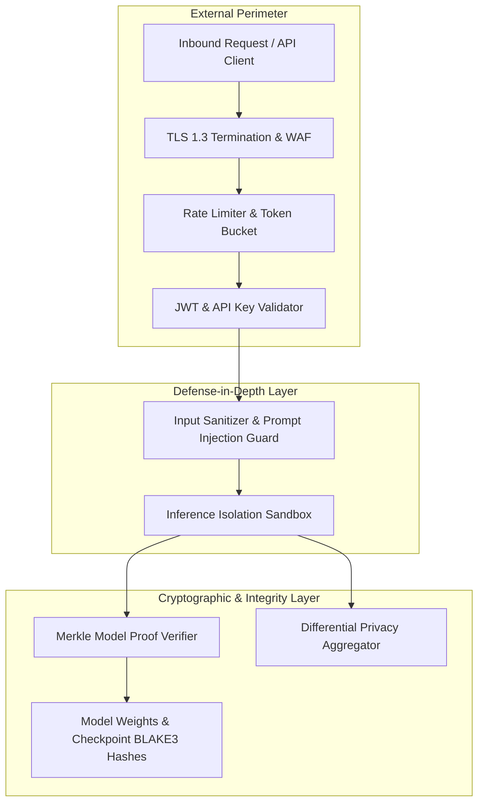

# 🛡️ TruthGPT Security Architecture & Implementation Guide

## Overview

The TruthGPT Optimization Core employs an enterprise-grade, defense-in-depth security framework designed to protect model integrity, training pipelines, inference APIs, and distributed consensus telemetry against state-of-the-art adversarial attacks.

This document serves as the operational security specification and handbook for deployers, auditors, and contributors.

---

## 🔒 Security Architecture Model

---

## 🛡️ Core Security Capabilities

### 1. Cryptographic Weight & Execution Integrity (Merkle Verifier)
- Every model checkpoint, quantization matrix, and hyperparameter configuration is anchored into a **Merkle Tree** using `BLAKE3` / `SHA-256`.
- Weights loaded from remote or local storage require cryptographic inclusion proofs against the canonical model root hash before execution.
- Prevents runtime model tampering, trojans, backdoors, and bit-flip attacks.

### 2. Prompt Injection & Adversarial Defense
- **Input Sanitization**: Multi-stage filtering against prompt injection, jailbreaking, Unicode homoglyphs, and delimiter collision.
- **Output Guardrails**: Automated scanning for sensitive data leakage (PII, API keys, credentials) before output streams are emitted.
- **Perplexity & Anomaly Monitoring**: Real-time detection of high-entropy adversarial perturbances designed to trigger denial-of-service in attention layers.

### 3. API & Communication Security
- **Strict TLS 1.3**: All external endpoints (REST, gRPC, WebSockets) require TLS 1.3 with forward secrecy.
- **JWT Authentication with Automatic Rotation**: Short-lived JSON Web Tokens (15-minute expiration) with RS256 / Ed25519 asymmetric signatures.
- **Tiered Rate Limiting**: Distributed token-bucket algorithm preventing DoS, resource starvation, and side-channel timing attacks.

### 4. Privacy-Preserving Computing
- **Differential Privacy ($\epsilon = 1.0, \delta = 10^{-5}$)**: Mathematical privacy guarantees during fine-tuning and federated updates.
- **Secure Multi-Party Computation (SMPC)**: Shamir secret sharing during collaborative parameter aggregation.
- **Zero-Knowledge Proofs (ZKP)**: Verification of model evaluation metrics without revealing proprietary test set data.

---

## 🚨 Threat Matrix & Mitigation Strategies

| Threat Vector | Severity | Attack Surface | TruthGPT Mitigation |
| :--- | :--- | :--- | :--- |
| **Model Weight Tampering** | Critical | Disk / Network / VRAM | Merkle inclusion proofs & BLAKE3 root verification. |
| **Prompt Injection / Jailbreak** | High | Inbound prompt payloads | Dual-tier semantic parser & input guardrail filters. |
| **Model Inversion / Data Stealing** | High | Inference output stream | Differential privacy & logit temperature clamping. |
| **Denial of Service (DoS)** | High | API endpoints & GPU queues | Adaptive rate limiting, request queue timeouts, circuit breakers. |
| **Dependency Supply Chain Attack**| Critical | Python / C++ packages | Pinned lockfiles, automated dependency CVE scanning (Trivy, Bandit).|
| **Side-Channel GPU Timing** | Medium | CUDA kernel execution | Constant-time activation padding & randomized batch batching. |

---

## 🔍 Security Auditing & Verification Checklist

Before deploying TruthGPT Optimization Core to production environments:

- [ ] **Cryptographic Roots**: Verify that `merkle_root` in `config.yaml` matches the official release hash.
- [ ] **Environment Isolation**: Ensure models run under a dedicated, unprivileged non-root user container (`uid=10001`).
- [ ] **Secret Management**: Confirm that all JWT private keys, API secrets, and TLS certificates are injected via secure secret stores (Vault / Kubernetes Secrets).
- [ ] **Rate Limiting Configuration**: Confirm rate limits match SLA tiers (`default: 100 req/min per IP`).
- [ ] **Logging & Telemetry**: Ensure no raw user prompt data or unmasked PII is persisted in logs or traces.

---

## 📞 Incident Response & Vulnerability Reporting

If you identify a security vulnerability or critical weakness:
1. **Do NOT** open a public issue.
2. Email the core security team at: **security@truthgpt.ai**.
3. Include detailed reproduction steps, threat impact, and affected version numbers.
4. Response timeline: Initial confirmation within 48 hours, resolution patch within 30 days.
