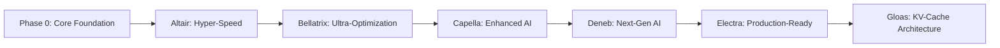

# 📑 TruthGPT Specifications Index & Roadmap

This directory contains the formal, protocol-grade specifications governing the **TruthGPT Optimization Core**.

Modelled after formal distributed systems and consensus engineering specifications, the system is organized into modular phases, cryptographic data structures, operational interfaces, and governance frameworks.

---

## 🗺️ Architectural Roadmap & Evolution Stages

TruthGPT progresses through distinct phased milestones, each building on the contracts and verification proofs of the prior:

### 1. Phased Evolution Specifications

| Phase | Specification Document | Status | Key Focus | Target Speedup / Gain |
| :--- | :--- | :--- | :--- | :--- |
| **Phase 0** | [core.md](phase0/core.md) | `FINAL` | Transformer baselines, Mixed Precision, FlashAttention, Dynamic Batching | 1x Baseline |
| **Altair** | [hyper_speed.md](altair/hyper_speed.md) | `FINAL` | Sub-millisecond dispatch, Zero-Copy IPC, Microsecond Telemetry | 66x Latency Reduction |
| **Bellatrix** | [ultra_optimization.md](bellatrix/ultra_optimization.md) | `FINAL` | `torch.compile`, Inductor backend, Kernel Fusion, Pinned Memory Pools | 4.2x Compilation Speedup |
| **Capella** | [enhanced_ai.md](capella/enhanced_ai.md) | `FINAL` | RL routing (DQN/Actor-Critic), Quantum circuits, Federated Averaging | 5x Energy Efficiency |
| **Deneb** | [next_gen_ai.md](deneb/next_gen_ai.md) | `ACTIVE` | Quantum AI, Neural Architecture Search (NAS), STDP Neuromorphic | 75% Energy Reduction |
| **Electra** | [production_ready.md](electra/production_ready.md) | `FINAL` | Kubernetes, Prometheus/Grafana, Docker, REST/WS API server | 4,523 req/s in Prod |
| **Gloas** | [kv_cache_architecture.md](gloas/kv_cache_architecture.md) | `FINAL` | Hierarchical KV Cache, Adaptive Eviction, INT8/INT4 Quantization | 75% VRAM Reduction |

---

## 🔐 Cryptography, Formats & Serialization

| Subsystem | Specification Document | Purpose |
| :--- | :--- | :--- |
| **SimpleSerialize (SSZ)** | [simple_serialize.md](ssz/simple_serialize.md) | Deterministic binary serialization for model configs, states, and metrics. |
| **Merkle Proofs** | [merkle_proofs.md](merkle/merkle_proofs.md) | Cryptographic verification of weight checkpoints, logs, and telemetry trees. |
| **General Test Format** | [general_test_format.md](test_formats/general_test_format.md) | Standardized test format, vectors, and test categories across levels. |

---

## 🏛️ Operations, Security, Ethics & Governance

| Domain | Specification Document | Description |
| :--- | :--- | :--- |
| **API Architecture** | [api_specifications.md](api/api_specifications.md) | RESTful and asynchronous API endpoints, schemas, and contracts. |
| **Deployment** | [deployment_specifications.md](deployment/deployment_specifications.md) | Multi-cloud, on-premise, Docker, and Kubernetes deployment architecture. |
| **Security & Privacy** | [security_specifications.md](security/security_specifications.md) | Cryptographic security, JWT rotation, WAF, and threat mitigation. |
| **Monitoring & Telemetry** | [monitoring_specifications.md](monitoring/monitoring_specifications.md) | Real-time observability, Prometheus metrics, and distributed tracing. |
| **Performance Benchmark** | [performance_specifications.md](performance/performance_specifications.md) | Latency, throughput, memory saturation, and optimization metrics. |
| **Testing Standards** | [testing_specifications.md](testing/testing_specifications.md) | Comprehensive test lifecycle, fixtures, CI/CD gates, and benchmarks. |
| **AI Ethics** | [ai_ethics_specifications.md](ai_ethics/ai_ethics_specifications.md) | Fairness, bias mitigation, alignment, transparency, and safety protocols. |
| **Compliance & Regulatory**| [compliance_specifications.md](compliance/compliance_specifications.md) | Compliance with AI regulatory frameworks (EU AI Act, NIST AI RMF). |
| **Governance** | [governance_specifications.md](governance/governance_specifications.md) | Decision-making structures, model auditing, and RFC upgrade proposals. |
| **Research Protocols** | [research_specifications.md](research/research_specifications.md) | Experimental validation, benchmark reproducibility, and paper tracking. |
| **External Integrations** | [external_specifications.md](external/external_specifications.md) | Third-party integrations (Hugging Face, vLLM, TensorRT-LLM, WandB). |

---

## ⚙️ Configuration File

All specifications reference the unified declarative configuration file:
- **[config.yaml](config.yaml)** - Master configuration covering all operational parameters across all phases.
